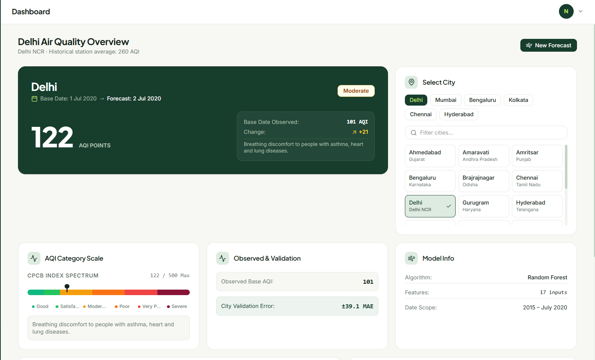
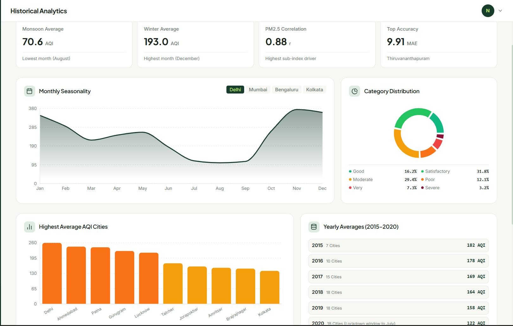
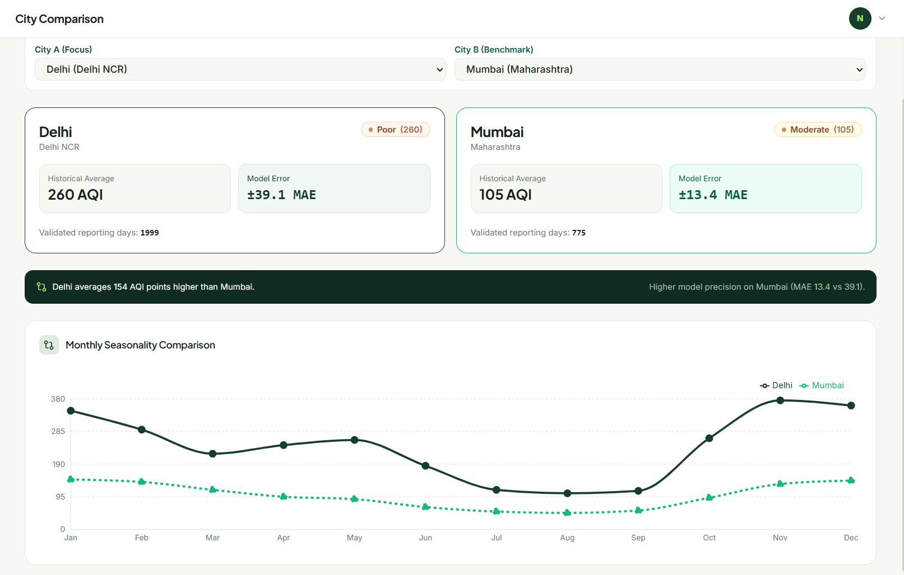
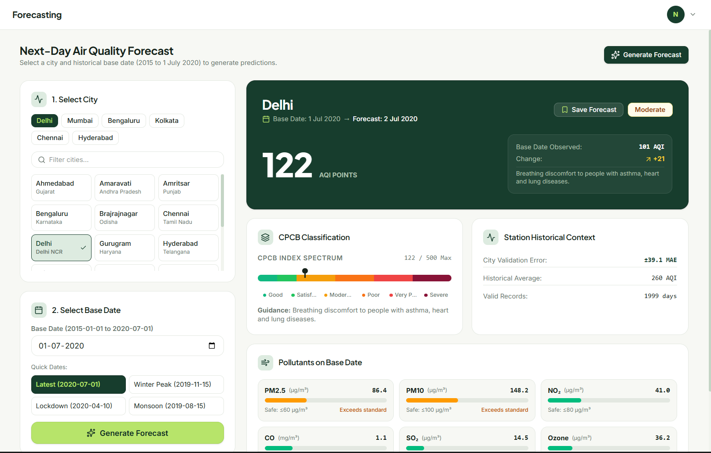
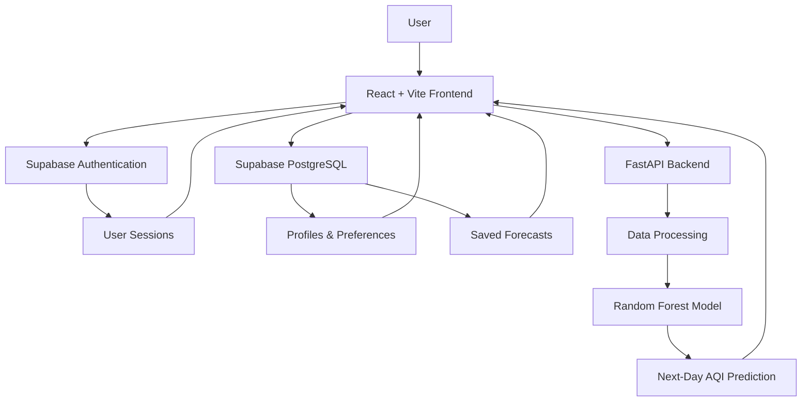

# 🌍 AQI Forecaster

<div align="center">


[](https://git.io/typing-svg)

<br/>

[](https://github.com/NPatel-ui/AQI-Forecaster/stargazers)
[](https://github.com/NPatel-ui/AQI-Forecaster/network)
[](https://github.com/NPatel-ui/AQI-Forecaster/issues)

<br/>

**An intelligent environmental analytics platform for exploring historical air pollution patterns, comparing cities, and forecasting next-day Air Quality Index (AQI) using Machine Learning.**

</div>

---

## 🌱 About The Project

Air pollution is one of the major environmental challenges affecting urban populations around the world.

Understanding air quality requires more than simply looking at an AQI number. Historical pollution patterns, city-level comparisons, data visualizations, and forecasting can help people better understand how air quality changes over time.

**AQI Forecaster** is an environmental data analytics and forecasting platform designed to make historical air pollution data easier to explore and understand.

The platform combines data visualization, machine learning, and an interactive web interface to provide insights into air quality trends and next-day AQI forecasts.

### 🎯 Project Objectives

- Analyze historical air pollution data.
- Explore AQI patterns across Indian cities.
- Visualize environmental trends through interactive charts.
- Compare air quality between different cities.
- Generate next-day AQI forecasts using Machine Learning.
- Provide an organized platform for environmental data exploration.

---

## ✨ Key Features

| Feature | Description |
|---|---|
| 📊 Interactive Dashboard | Explore AQI information and city-level summaries. |
| 📈 Historical Analytics | Study seasonal patterns, AQI distributions and historical trends. |
| 🌆 City Analysis | Analyze historical air quality across supported cities. |
| 🔮 AQI Forecasting | Generate next-day AQI predictions using a Random Forest model. |
| ⚖️ City Comparison | Compare historical air quality between cities. |
| 👤 User Authentication | Signup, email verification and login using Supabase. |
| 🗂️ User Profiles | Manage personal information and preferences. |
| ⭐ Saved Forecasts | Save and retrieve forecasts associated with your account. |
| 📊 Data Visualization | Explore environmental data through interactive charts and graphs. |

---

## 🖥️ Application Screenshots

Explore the actual AQI Forecaster application.

### 1. Dashboard

The main dashboard provides an overview of historical air quality, selected city information, AQI classification, and model context.

<div align="center">



</div>

### 2. Historical Analytics

Explore historical pollution patterns through monthly seasonality, AQI category distribution, city-level averages, and yearly analysis.

<div align="center">



</div>

### 3. City Comparison

Compare historical AQI averages, model errors, reporting records, and monthly seasonal patterns across two cities.

<div align="center">



</div>

### 4. Next-Day AQI Forecasting

Select a supported city and historical base date to generate a next-day AQI prediction, with CPCB classification and pollutant context.

<div align="center">



</div>

---

## 🧠 Machine Learning

AQI Forecaster uses a **Random Forest Regressor** to estimate next-day AQI values using historical environmental information.

### Model Information

| Component | Details |
|---|---|
| Algorithm | Random Forest Regressor |
| Learning Type | Supervised Machine Learning |
| Problem Type | Regression |
| Dataset | Air Quality Data in India |
| Dataset Source | Kaggle – Rohan Rao |
| Training Framework | Scikit-learn |
| Missing Value Handling | Median Imputation |
| Input Features | 17 features |

### 📊 Model Evaluation

The model was evaluated using held-out test data.

| Evaluation Metric | Test A | Test B |
|---|---:|---:|
| MAE | 22.3391 | 17.0824 |
| RMSE | 34.7380 | 24.7688 |
| R² Score | 0.8606 | 0.8482 |

**Held-out city validation:**

- MAE: 21.7067
- RMSE: 33.6951
- R² Score: 0.8633

These are recorded evaluation results, not guaranteed prediction accuracy for every city or date.

---

## 📂 Dataset Information

The project uses the **Air Quality Data in India** dataset by Rohan Rao.

| Dataset Property | Information |
|---|---|
| File | `city_day.csv` |
| Total Records | 29,531 |
| Total Columns | 16 in the original dataset |
| Cities | 26 |
| Start Date | 1 January 2015 |
| End Date | 1 July 2020 |
| Data Type | Historical air quality measurements |

The dataset contains historical AQI measurements and pollutant information, including different air pollution indicators.

> **Important:** The current dataset ends on 1 July 2020. AQI Forecaster currently provides historical analytics and historical next-day forecasting. It does not provide live AQI monitoring.

---

## 🏗️ System Architecture

AQI Forecaster uses a modular architecture in which the frontend, authentication service, database, and machine learning backend have separate responsibilities.



### Architecture Responsibilities

| Component | Responsibility |
|---|---|
| React + Vite | User interface and application experience |
| Supabase Auth | Signup, login, email verification and sessions |
| Supabase PostgreSQL | User profiles, preferences and saved forecasts |
| FastAPI | Machine learning API and forecast requests |
| Scikit-learn | Random Forest AQI prediction model |

---

## ⚙️ Technology Stack

<div align="center">

### Frontend


### Backend


### Machine Learning & Data Science


### Database & Services


</div>

---

## 🚀 Getting Started

Follow these instructions to run the project locally.

### 1. Clone the Repository

```bash
git clone https://github.com/NPatel-ui/AQI-Forecaster.git

cd AQI-Forecaster
```

### 2. Frontend Setup

Navigate to the frontend directory:

```bash
cd frontend
```

Install dependencies:

```bash
npm install
```

Create a `.env` file inside the frontend directory:

```env
VITE_SUPABASE_URL=your_supabase_project_url
VITE_SUPABASE_PUBLISHABLE_KEY=your_supabase_publishable_key
```

Start the frontend:

```bash
npm run dev
```

### 3. Backend Setup

Open another terminal at the repository root.

Navigate to the backend:

```bash
cd backend
```

Create a Python virtual environment:

```bash
python -m venv venv
```

Activate it on Windows:

```bash
venv\Scripts\activate
```

Install dependencies:

```bash
pip install -r requirements.txt
```

Start FastAPI from the backend directory:

```bash
uvicorn src.main:app --reload
```

The API documentation is generally available at:

```text
http://127.0.0.1:8000/docs
```

### 4. Supabase Configuration

1. Create a Supabase project.
2. Execute the SQL schema provided in `frontend/supabase/schema.sql`.
3. Configure authentication Site URL and Redirect URLs.
4. Add the project URL and publishable key to `frontend/.env`.
5. Restart the Vite development server.

Never commit your actual `.env` file or expose a Supabase secret/service-role key.

---

## 🔌 API Endpoints

The existing FastAPI backend exposes the following endpoints:

| Method | Endpoint | Description |
|---|---|---|
| GET | `/` | Backend root endpoint |
| GET | `/health` | Health check |
| POST | `/predict` | Prediction endpoint |
| GET | `/forecast/{city}?date=YYYY-MM-DD` | Generate a next-day AQI forecast using historical features for the specified date |

The forecast endpoint uses the requested historical feature date to generate a prediction for the following calendar day.

---

## 🔐 Security

AQI Forecaster uses Supabase security features to protect user-owned information.

- Supabase Auth handles user authentication.
- Row Level Security protects user-owned database records.
- Users can access only their own profiles and saved forecasts.
- Publishable keys are used for frontend integration.
- Secret and service-role keys must remain private.

---

## 🗺️ Future Improvements

- 🌐 Integration of live AQI data sources.
- 🛰️ Real-time air pollution monitoring.
- 🌍 More geographical coverage.
- 📍 Location-based AQI insights.
- 📱 Mobile application support.
- 🧠 Experiments with additional machine learning models.
- 📊 More advanced environmental analytics.
- 🔔 Personalized air quality notifications.

---

## 🤝 Contributing

Contributions, suggestions, and improvements are welcome.

1. Fork the repository.
2. Create a new feature branch.
3. Make your changes.
4. Commit your changes.
5. Submit a pull request.

```bash
git checkout -b feature/your-feature-name

git add .

git commit -m "Add: your feature description"

git push origin feature/your-feature-name
```

---

## 👨‍💻 Author

<div align="center">

### Nitya Patel

**B.Sc. Information Technology | AI/ML Enthusiast | Developer**

Building technology-driven solutions using Machine Learning, data analytics, and modern web development.

[](https://github.com/NPatel-ui)

[](https://github.com/NPatel-ui/AQI-Forecaster)

</div>

---

<div align="center">

### 🌍 Making Air Quality Data Easier to Understand.

**Explore. Analyze. Forecast. Understand.**


</div>
